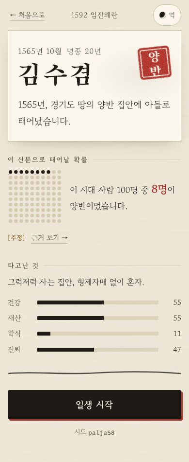
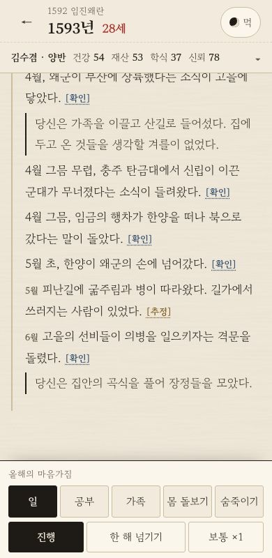
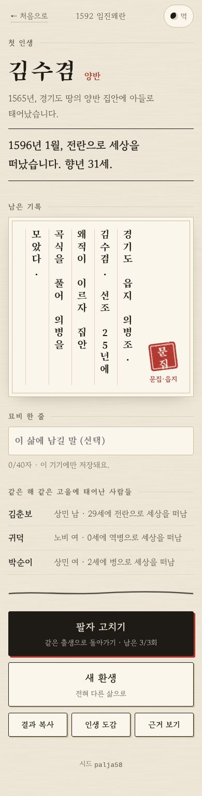
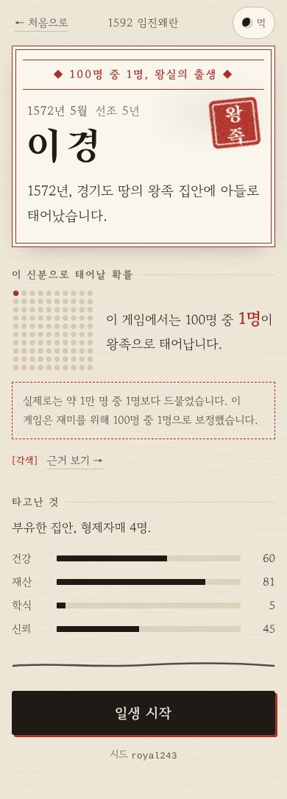
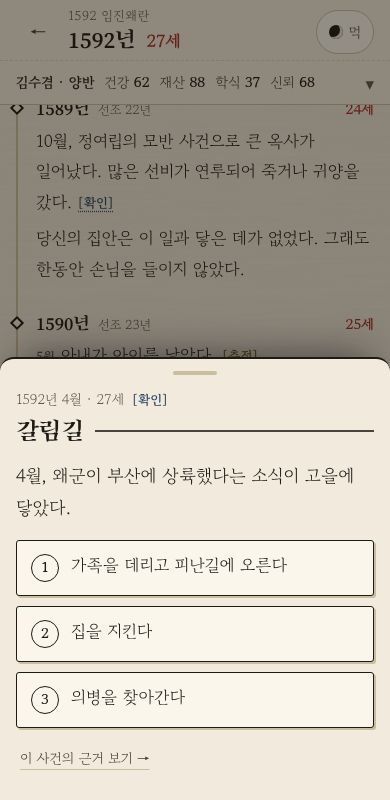
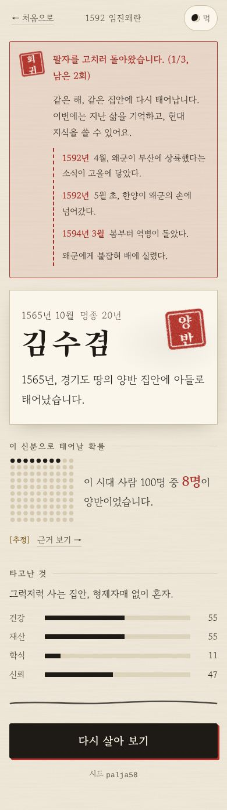
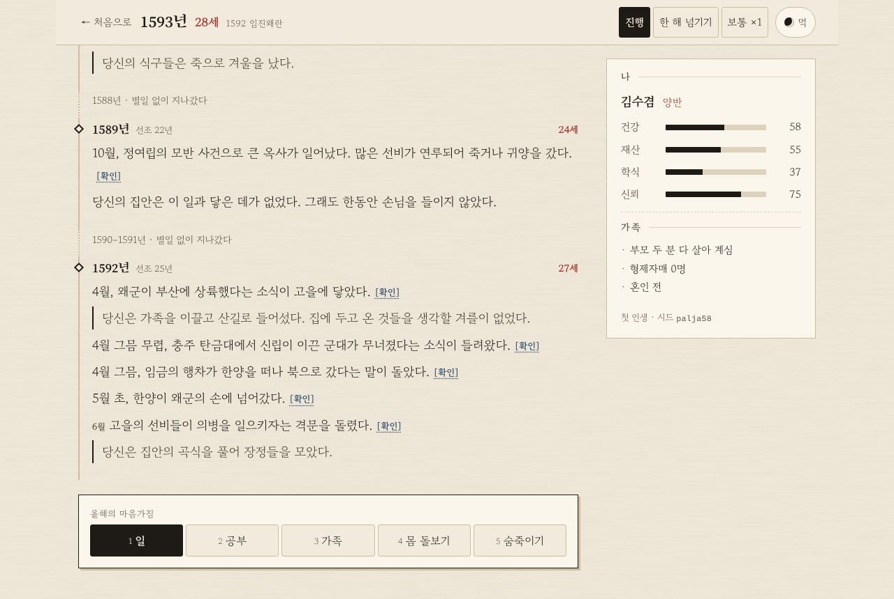
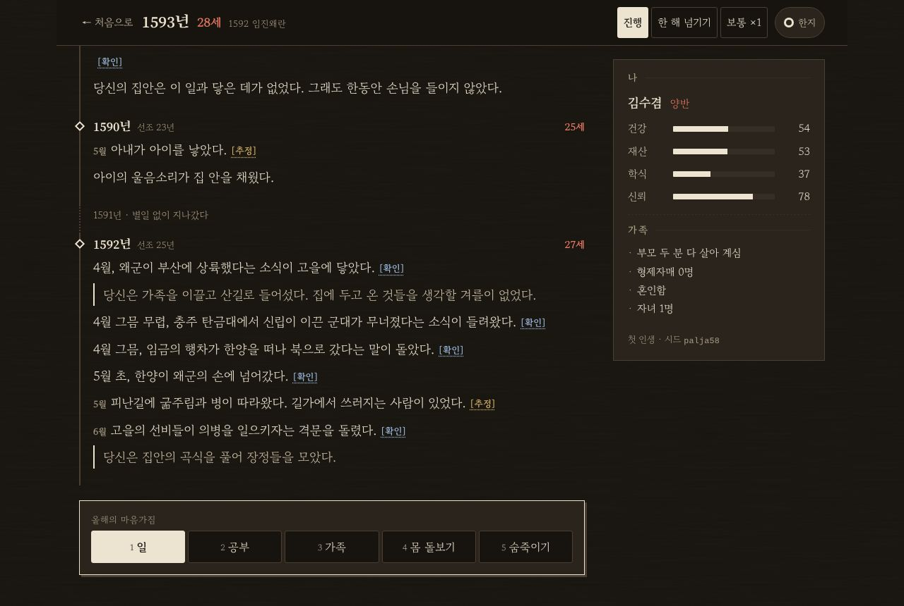

# 팔자록 — 다시 태어나는 기록

**삼국에서 조선까지, 이 땅 어딘가에 무작위로 태어나 한 번의 일생을 사는 텍스트 인생 시뮬레이션.**
죽으면 같은 삶으로 돌아가 **팔자를 고치거나**, 전혀 다른 삶으로 다시 태어납니다.

▶ **플레이: https://palja.leetaewon.dev** (휴대폰에서 바로 열립니다. 설치·가입 없음)

<p>
  
  
  
</p>

## 어떤 게임인가요

- **출생은 무작위입니다.** 660 백제 멸망 · 1170 무신정변 · 1592 임진왜란 · 1800년대 세도정치 가운데 한 시대, 그 시대의 신분 비율대로 한 신분에 태어납니다. 백성이나 노비로 태어나는 일이 가장 흔합니다.
- **한 해가 한 줄입니다.** 연대기에 담담한 문장이 쌓이고, 열 살부터는 해마다 마음가짐(일·공부·가족·몸 돌보기·숨죽이기)을 고릅니다. 갈림길이 오면 멈춰서 선택을 기다립니다.
- **이 시대에는 일찍 죽는 사람이 많았습니다.** 평균 사망 나이는 20대 중반, 셋 중 하나는 다섯 살을 넘기지 못합니다. 전쟁·역병·흉년이 신분을 가리지 않고 찾아옵니다.
- **엔딩은 "남은 기록"입니다.** 대부분의 삶은 어디에도 기록되지 않고, 일부는 호적·족보에 한 줄, 드물게 문집이나 실록에 이름이 남습니다.
- **팔자 고치기(회귀)**: 죽은 뒤 같은 해, 같은 집안으로 돌아갑니다(한 인생에 3번). 지난 삶의 기억과 현대 지식을 쓸 수 있지만, 신분이 닿는 범위(가족·마을·고을·나라)까지만 세상을 바꿀 수 있습니다.
- 왕족으로 태어날 확률은 재미를 위해 **100명 중 1명**으로 보정했고, 게임 안에서 그렇다고 알립니다. 실제로는 1만 명 중 1명보다 드물었습니다.
- 인생 도감, 시드로 같은 출생 다시 하기, 결과 복사, 묘비 한 줄. 진행 상황은 이 기기의 브라우저에만 저장됩니다.

권장 나이 15세 이상. 전쟁·역병·신분 차별·어린 죽음 같은 무거운 소재를 담담하게 다룹니다.

### 화면

| 출생 | 왕족 출생 | 갈림길 | 회귀한 삶 |
|---|---|---|---|
|  |  |  |  |

| 큰 화면 · 일생 (한지) | 큰 화면 · 일생 (먹) |
|---|---|
|  |  |

모든 스크린샷(360·390·1280px × 라이트·다크)은 [`docs/screenshots/`](docs/screenshots/)에 있습니다.

### 접근성

- 모바일 우선(360px부터), 라이트 기본 + 다크 전환, 명도 대비 WCAG AA(라이트·다크 모두, `tests/contrast.test.ts`)
- 큰 화면에서는 키보드만으로 끝까지 플레이: 숫자키로 마음가짐·선택지, 스페이스 진행·멈춤, → 한 해 넘기기, Enter 기록 보기
- 스크린 리더: 해마다 그해 일어난 일을 한 번 읽어 줍니다. 화면마다 axe(WCAG 2.1 AA) 점검을 E2E로 돌립니다(`e2e/a11y.spec.ts`)
- 기기에서 "동작 줄이기"를 켜면 출생 공개·회귀 전환·기록 엔딩 연출이 꺼집니다. 연출은 화면을 한 번 누르면 건너뜁니다

## 근거와 영감

- 출생 확률, 연표 사건, 수명은 역사 연구를 바탕으로 했지만 **추정과 게임 각색이 섞여 있습니다.** 게임 안 「근거 보기」에서 사건마다 근거와 신뢰도([확인]·[추정]·[각색])를 볼 수 있습니다.
- 근거 문서:
  - [시대별 신분 구성 추정](docs/02-research/status-ratios.md)
  - [수명·사망 원인과 게임 사망 모델](docs/02-research/life-death.md)
  - 시점별 조사: [660 백제 멸망](docs/02-research/eras/0660-baekje-fall.md) · [1170 무신정변](docs/02-research/eras/1170-military-coup.md) · [1592 임진왜란](docs/02-research/eras/1592-imjin-war.md) · [1800년대 세도정치](docs/02-research/eras/1800s-sedo-politics.md)
  - [참고 문헌·사료 목록](docs/02-research/sources.md)
- 사망 모델이 맞는지는 1만 인생 시뮬레이션으로 확인합니다: [시뮬레이션 보정 기록](docs/sim-report.md)
- 게임 안의 인물은 모두 가상 인물입니다. 실존 인물의 속마음·대사는 쓰지 않습니다.
- **영감**: 현대 통계로 무작위 출생을 체험하는 「80억분의 1」(1in8b.life). 이 게임은 공간 대신 시대를, 나라 대신 신분을 뽑고, 회귀라는 장치를 더했습니다. 화면과 문구는 따로 만들었습니다.
- 기획과 조사는 사람이, 구현과 문장 작업은 Claude와 함께 했습니다.

## 개발

Vite + React + TypeScript. 게임 규칙(`src/engine/`)은 순수 TypeScript이고, 사건·지식·기록은 모두 `content/`의 JSON 데이터입니다. 서버는 없습니다.

```bash
npm ci
npm run dev          # 개발 서버
npm run test         # Vitest: 엔진, 콘텐츠 스키마 검증, 시뮬레이션 보정 목표, 명도 대비
npm run lint         # ESLint (엔진 순수성, Math.random 금지 포함)
npm run build        # 타입 검사 + 프로덕션 빌드 → dist/
npm run sim:lives    # 1만 인생 시뮬레이션 리포트 (-- --era 1592, -- --n 2000, -- --json)
npx playwright install chromium   # E2E를 처음 돌릴 때
npm run e2e          # Playwright: 4개 시점 플레이, 키보드 완주, 접근성(axe), 연출
npm run screenshots  # docs/screenshots/ 다시 찍기
```

Node 22 (`.node-version`). 배포는 Cloudflare Pages Git 연동입니다. `main`에 병합하면 프로덕션, 브랜치·PR은 미리보기가 만들어집니다(빌드 명령 `npm run build`, 출력 `dist`). 사이트 절대 주소는 `VITE_SITE_URL` 또는 `src/site.ts` 한 곳에서 바꿉니다(지금 `https://palja.leetaewon.dev`, Pages 프로젝트 `palja-game`의 사용자 설정 도메인).

| 위치 | 담는 것 |
|---|---|
| `src/engine/` | 출생·일생·사건·회귀·사망·기록 판정 (시드 난수, DOM 없음) |
| `src/ui/` | 화면 (`screens/`, `components/`, `styles.css`) |
| `content/` | 시대·신분·사건·현대 지식·기록 템플릿·근거 요약 (JSON). 형식은 [`docs/03-design/content-schema.md`](docs/03-design/content-schema.md) |
| `sim/` | 자동 선택 봇으로 인생을 대량으로 돌리는 시뮬레이터 |
| `tests/`, `e2e/` | 단위·콘텐츠 테스트, 브라우저 E2E |
| `docs/` | [기획 Brief](docs/00-brief/brief.md) · [PRD](docs/01-prd/prd.md) · [근거 조사](docs/02-research/) · [문체 가이드](docs/03-design/writing-guide.md) · [결정 기록](docs/04-decisions.md) |

새 시대나 사건을 더하는 방법, 진행 상황은 [`PROGRESS.md`](PROGRESS.md)와 [`CLAUDE.md`](CLAUDE.md)에 있습니다.
